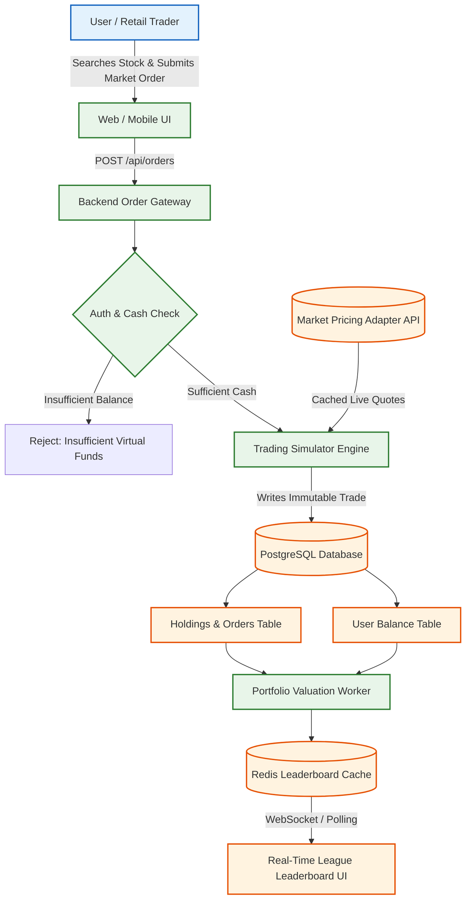
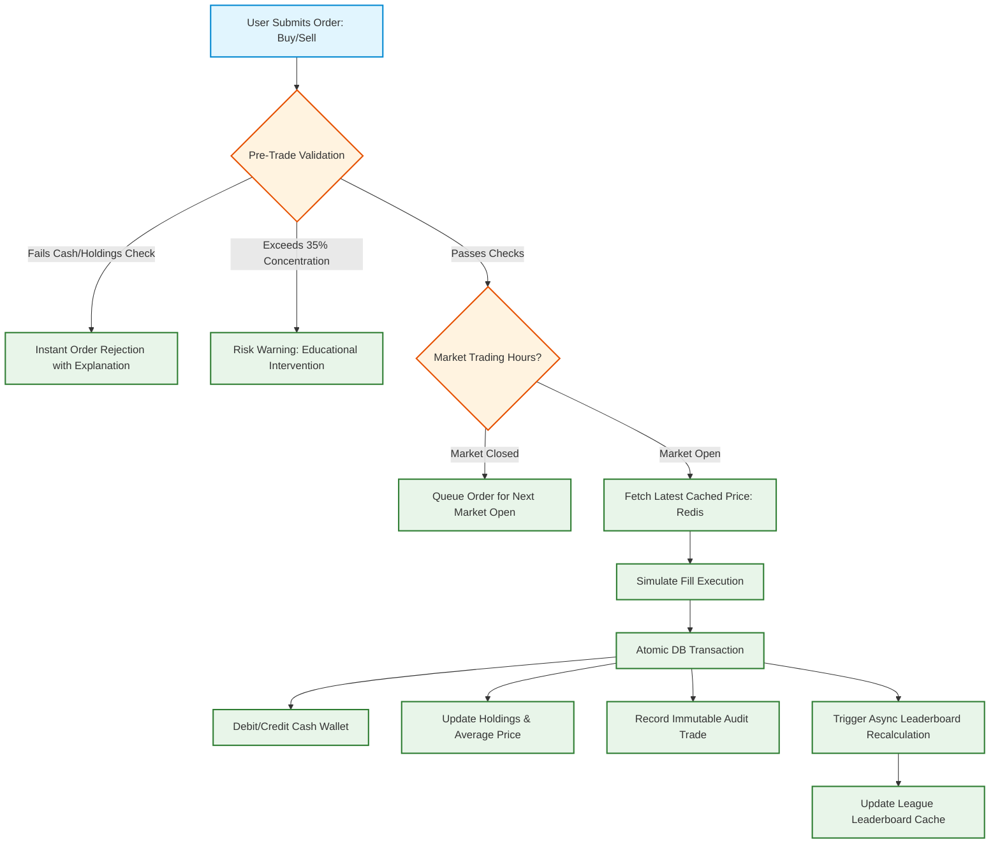
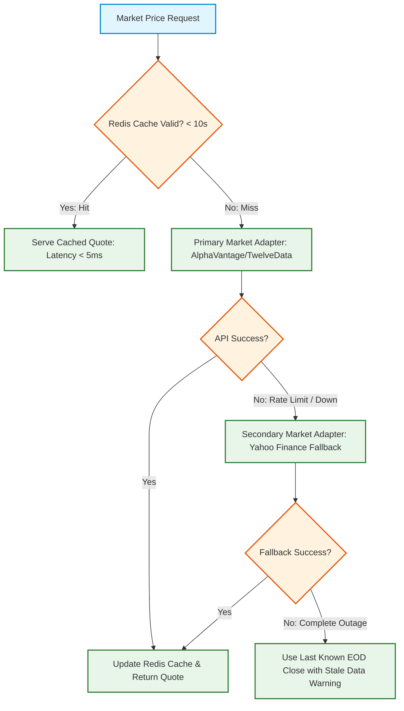

# Product Requirements Document (PRD): On-Demand (Social Paper Trading & Portfolio Simulation Platform)

**Product Lead:** Uday Kiran  
**Status:** Architecture & Specifications Complete / Prototype Scaffolding  
**Tech Stack:** Next.js 14, Node.js/TypeScript, PostgreSQL (Prisma ORM), Redis, Socket.io, Market Data Pricing Adapters  

---

## 1. Executive Summary

### 1.1 Context & Background
Retail investing has exploded among students, early-career engineers, and young professionals. However, the barrier to sustainable market engagement remains punishingly steep. Beginners who enter real financial markets with personal savings frequently suffer rapid capital drawdowns within their first 90 days. The psychological impact of losing real money induces extreme risk aversion, emotional panic-selling, and eventual total disengagement from financial literacy.

Conversely, the existing ecosystem of paper trading simulators suffers from severe usability and engagement failures. Most retail brokerage paper trading tools look like sterile, clunky institutional terminal clones from the late 1990s. They isolate the learner in a solitary spreadsheet interface, completely disconnected from the social reality of modern retail traders who discover ideas, debate earnings reports, and benchmark strategies across peer communities on WhatsApp, Telegram, Discord, and Reddit.

### 1.2 The Product Solution
I conceptualized and architected **On-Demand** as a social, gamified paper-trading and portfolio simulation ecosystem. Rather than treating financial education as a dry solitary calculation, On-Demand bridges the gap between market-realistic trade execution and collaborative community competition. 

Users trade equities using virtual seed capital (`₹1,00,000` INR default) pegged to real-world market pricing feeds, organize and join private or public competitive leagues, benchmark their returns against peers in real-time, and learn disciplined portfolio risk management through verified trade audit trails and community transparency.

---

## 2. Product Vision & North Star

### 2.1 Product Vision
"Financial Literacy through Risk-Free Experimentation & Peer Collaboration." We believe everyone deserves a safe, engaging, and transparent environment to build financial confidence before risking hard-earned capital.

### 2.2 North Star Metric
*Time-to-First-Trade (TTFT) & 30-Day Simulated Strategy Retention:* Reducing the median time from registration to placing the first simulated trade to < 90 seconds, combined with achieving > 45% active 30-day league participation across cohorts.

### 2.3 Supporting Key Performance Indicators (KPIs)
1.  **League Virality (K-Factor):** > 1.8 organic league invites sent and accepted per active league creator.
2.  **Portfolio Diversification Score:** > 65% of active league participants holding assets across 3 or more distinct industrial sectors (discouraging single-stock reckless gambling).
3.  **Order Execution Latency:** < 300ms simulated fill latency from user submit click to portfolio holding update.

---

## 3. Problem Statement

### 3.1 The Psychological Capital Trap
Testing a new thesis or trading strategy with real capital induces severe loss aversion. Novices either trade with paralyzing fear or freeze completely. When an early trade goes negative, retail beginners panic-sell at the market trough and abandon investing permanently.

### 3.2 The Dry Simulation Void & Solitary Disengagement
Traditional paper-trading software feels like an institutional accounting tool. It provides zero social motivation, peer benchmarking, or shared excitement. Without community accountability, learners lose interest after placing two trades and forget the platform.

### 3.3 The Realism Deficit & Reckless Gaming Exploits
Casual stock simulation games often permit unlimited resets or 100x artificial leverage without borrow fees. When users can reset their account balance with one click after blowing up a portfolio, they develop terrible gambling habits instead of sound risk management.

### 3.4 Market Data Pricing Inaccessibility
Direct real-time streaming equity feeds cost thousands of dollars per month in enterprise exchange licensing fees. Retail simulation platforms must balance high quote fidelity with sustainable, cached API query economics.

---

## 4. Goals & Non-Goals

### 4.1 Goals
*   **G-01 (Instant Simulated Wallet Seeding):** Automatically initialize each user with `₹1,00,000` virtual cash upon account creation.
*   **G-02 (Realistic Market Order Execution):** Simulate market buy/sell orders with real pricing, calculating weighted average cost and deducting cash balances idempotently.
*   **G-03 (Social League Infrastructure):** Enable users to create custom private/public leagues with start/end dates, entry rules, and shareable invite codes.
*   **G-04 (Real-Time Leaderboard Engine):** Calculate portfolio valuations asynchronously and rank league members by absolute return and percentage P&L.
*   **G-05 (Anti-Gaming Guardrails):** Prohibit account resets during an active competitive league and enforce position-sizing limits to discourage single-stock coin-flip bets.
*   **G-06 (Peer Rationale Transparency):** Allow verified participants to optionally publish brief trade rationales visible on league leaderboards.

### 4.2 Non-Goals
*   **NG-01 (Real Money Brokerage / Custody):** No real financial deposits, bank withdrawals, or regulatory broker-dealer custody.
*   **NG-02 (High-Frequency Algorithmic Execution):** No colocation, fix protocols, or sub-millisecond execution guarantees.
*   **NG-03 (SEBI/SEC Regulated Financial Advice):** Platform is strictly educational and non-advisory; no trade signals or guaranteed tips.
*   **NG-04 (Complex Exotic Derivatives):** No multi-leg options, binary futures, or credit default swaps in MVP.

---

## 5. Users & Personas (The Human Element)

### 5.1 Persona 1: The Curious Novice (The Learner)
*   **Profile:** A university student or early-career professional curious about equities but terrified of losing savings.
*   **Emotional State:** Intimidated by complex stock market jargon (P/E ratios, order book depths, margin calls).
*   **The Need:** A clean, friendly mobile-web interface where they can buy shares in companies they recognize (e.g., Apple, Reliance, Infosys, Tata Motors) and observe returns safely.

### 5.2 Persona 2: The Competitive Strategist (The League Master)
*   **Profile:** An active market hobbyist who loves researching quarterly earnings and wants to prove their stock-picking skills against friends.
*   **Emotional State:** Frustrated by boring mock tools; wants competitive excitement and bragging rights.
*   **The Need:** Create a 30-day sprint league for their college club or office colleagues, share an invite link, and monitor real-time rankings on a leaderboard.

### 5.3 Persona 3: The Collaborative Mentor (The Sharer)
*   **Profile:** An experienced investor who enjoys teaching friends and sharing sound diversification strategies.
*   **The Need:** Public audit trails and clean portfolio distribution cards that demonstrate disciplined risk management without exposing personal net worth.

---

## 6. End-to-End User Journey (Social Trading Triangulation)



---

## 7. Product Scope

### 7.1 Scope Matrix (Executed vs Planned vs Out of Scope)

| Capability / Module | MVP (Executed) | Phase 2 (Planned) | Out of Scope |
| :--- | :---: | :---: | :---: |
| **Simulated Cash Wallet (`₹1,00,000`)** | Yes | Multiple custom currency seeding | Real fiat currency deposits |
| **Market Equity Buy/Sell Orders** | Yes | Limit & Stop-loss orders | High-frequency direct DMA |
| **Cached Quote Adapter (5s-15s TTL)** | Yes | Streaming WebSocket ticker | Direct enterprise FIX gateway |
| **Private Social Leagues (Invite Codes)** | Yes | Corporate sponsored leagues | Real money wagering / stakes |
| **Dynamic League Leaderboards** | Yes | Historical league replay charts | Algorithmic copy-trading pools |
| **Position Sizing Cap (Max 35% single asset)** | Yes | Configurable league risk rules | Unlimited margin gambling |
| **Trade Rationale Notes** | Yes | Social comment upvoting | Financial advisory chat rooms |
| **Options & Futures Chains** | No | Basic covered calls | Complex exotic swaps |

---

## 8. Functional Requirements (16 Formal Specifications)

### 8.1 Module 1: User Account & Virtual Wallet (UAW)

#### FR-UAW-01: Instant Virtual Wallet Provisioning
*   **Priority:** P0 (Critical)
*   **Description:** Every newly authenticated user must have a simulated cash account provisioned immediately with a default balance of `₹1,00,000.00` INR.
*   **Acceptance Criteria:**
    *   *Given* a user signs up via OAuth or email,
    *   *When* account creation completes,
    *   *Then* an immutable row in `user_wallets` is generated with `available_cash = 100000.00`.

#### FR-UAW-02: Isolated League Cash Allocation
*   **Priority:** P0 (Critical)
*   **Description:** Users joining a specific league must receive an isolated virtual wallet dedicated exclusively to that league, preventing balance bleeding across competitions.
*   **Acceptance Criteria:**
    *   *Given* a league configured with `starting_balance = 50000`,
    *   *When* a user joins the league,
    *   *Then* a distinct `league_wallets` record is instantiated with `₹50,000`.

#### FR-UAW-03: Anti-Gaming Reset Protection
*   **Priority:** P1 (High)
*   **Description:** Users may only request a simulated wallet balance reset when they are not enrolled in any currently active, in-progress competitive league.
*   **Acceptance Criteria:**
    *   *Given* a user participating in an active sprint league,
    *   *When* attempting to trigger account reset,
    *   *Then* the system rejects the operation: *"Cannot reset wallet while participating in active competitive leagues."*

#### FR-UAW-04: Position Sizing Risk Guardrail
*   **Priority:** P1 (High)
*   **Description:** In default leagues, no single stock holding may exceed 35% of total portfolio net asset value at the time of order placement.
*   **Acceptance Criteria:**
    *   *Given* a portfolio with total NAV `₹1,00,000`,
    *   *When* a user places an order for `₹40,000` in a single equity,
    *   *Then* the order is rejected with an educational alert: *"Order exceeds 35% concentration limit. Maintain portfolio diversification."*

### 8.2 Module 2: Trading Engine & Market Simulator (TEMS)

#### FR-TEMS-01: Real-Time Equity Search & Symbol Autocomplete
*   **Priority:** P0 (Critical)
*   **Description:** The system must provide instant autocomplete search across Indian and US listed equities by symbol or company name.
*   **Acceptance Criteria:**
    *   *Given* a user types "RELI",
    *   *When* debounce period of 250ms elapses,
    *   *Then* results return ticker symbol, company name, exchange (NSE/BSE), and latest cached price.

#### FR-TEMS-02: Market Buy Order Execution
*   **Priority:** P0 (Critical)
*   **Description:** When placing a market buy order, the simulator verifies sufficient cash, debits cash balance, creates an immutable `trades` row, and updates `holdings` with recalculation of weighted average purchase price.
*   **Acceptance Criteria:**
    *   *Given* available cash `₹50,000` and stock quote `₹2,500`,
    *   *When* buying 10 shares,
    *   *Then* `₹25,000` is deducted, holdings reflect 10 shares at `₹2,500` average cost, and status is `executed`.

#### FR-TEMS-03: Market Sell Order Execution & P&L Realization
*   **Priority:** P0 (Critical)
*   **Description:** When placing a market sell order, the system checks sufficient shares owned, credits cash, decreases holding quantity, and records realized profit or loss.
*   **Acceptance Criteria:**
    *   *Given* 10 shares owned at `₹2,000` average cost,
    *   *When* selling 5 shares at current price `₹2,400`,
    *   *Then* cash increases by `₹12,000`, remaining holdings become 5 shares, and realized P&L is recorded as `+₹2,000`.

#### FR-TEMS-04: Market Hours & Order Queuing
*   **Priority:** P1 (High)
*   **Description:** If an order is submitted outside active exchange trading hours, it is placed in an `after_hours_queued` state and executes at market opening bell.
*   **Acceptance Criteria:**
    *   *Given* an order placed on Sunday,
    *   *When* the system evaluates exchange open state,
    *   *Then* the order is queued and user is notified: *"Market closed. Order queued for Monday opening."*

### 8.3 Module 3: Social Leagues & Community Benchmarking (SLCB)

#### FR-SLCB-01: Custom League Creation
*   **Priority:** P0 (Critical)
*   **Description:** Authenticated users can create custom trading leagues, specifying name, description, duration (1 week, 1 month, quarterly), privacy level (public/private), and starting cash.
*   **Acceptance Criteria:**
    *   *Given* valid league parameters,
    *   *When* a user clicks "Create League",
    *   *Then* a new league is initialized and a unique 6-character alphanumeric invite code is generated.

#### FR-SLCB-02: Private Invite Code Enrollment
*   **Priority:** P0 (Critical)
*   **Description:** Users can join private leagues by entering an alphanumeric invite code or clicking a deep link (`/leagues/join?code=XYZ123`).
*   **Acceptance Criteria:**
    *   *Given* valid code `FIN101`,
    *   *When* a new user joins,
    *   *Then* the user is enrolled into the league roster with their dedicated league wallet.

#### FR-SLCB-03: Dynamic Leaderboard Computation
*   **Priority:** P0 (Critical)
*   **Description:** The system periodically recalculates total portfolio net asset value (`NAV = Cash + SUM(Holdings * Latest Price)`) for all league members and maintains rank tables.
*   **Acceptance Criteria:**
    *   *Given* updated equity quotes,
    *   *When* the leaderboard valuation worker executes,
    *   *Then* user ranks are sorted in descending order of percentage return: `((Current NAV - Initial Cash) / Initial Cash) * 100`.

#### FR-SLCB-04: Peer Portfolio Inspection & Privacy Toggles
*   **Priority:** P1 (High)
*   **Description:** League members can view the asset allocation percentage (e.g., 40% Tech, 30% Energy, 30% Cash) of fellow participants to foster collective learning.
*   **Acceptance Criteria:**
    *   *Given* a league leaderboard row,
    *   *When* a participant clicks a peer avatar,
    *   *Then* an asset allocation chart appears showing percentage holdings without exposing real currency values if privacy mode is enabled.

### 8.4 Module 4: Market Data Ingestion & Caching Engine (MDICE)

#### FR-MDICE-01: Decoupled Pricing Adapter
*   **Priority:** P0 (Critical)
*   **Description:** The backend market pricing service must implement a unified interface abstracting third-party providers (Alpha Vantage, Yahoo Finance, Twelve Data).
*   **Acceptance Criteria:**
    *   *Given* a request for ticker quote `INFY`,
    *   *When* the active provider fails,
    *   *Then* the adapter automatically falls back to secondary provider without throwing client-facing 500 errors.

#### FR-MDICE-02: In-Memory Redis Quote Caching
*   **Priority:** P0 (Critical)
*   **Description:** All queried market quotes must be cached in Redis with a 10-second TTL to keep API consumption within sustainable quota boundaries.
*   **Acceptance Criteria:**
    *   *Given* 100 users querying `AAPL` within 8 seconds,
    *   *When* price requests arrive,
    *   *Then* only 1 external API call is made; remaining 99 are served directly from cache.

#### FR-MDICE-03: Historical EOD Chart Data Ingestion
*   **Priority:** P1 (High)
*   **Description:** The platform stores and serves daily end-of-day (EOD) candle charts (1-month, 6-month, 1-year) for all supported equities.
*   **Acceptance Criteria:**
    *   *Given* a user inspecting a stock detail page,
    *   *When* selecting the "6M" timeframe,
    *   *Then* an interactive lightweight candlestick/line chart displays historical price trajectory.

#### FR-MDICE-04: Immutable Audit Logging
*   **Priority:** P0 (Critical)
*   **Description:** Every order placement, execution, rejection, and league balance adjustment must generate an immutable log entry in `audit_logs` preventing tamper disputes.
*   **Acceptance Criteria:**
    *   *Given* any financial transaction event,
    *   *When* committed to database,
    *   *Then* client IP, timestamp, price tick, and order payload are recorded in an append-only table.

---

## 9. Application Lifecycle & The Epistemic Permission Engine

In a financial simulation, clarity regarding state transitions and execution certainty is paramount.



---

## 10. Data Requirements & Master Schema

The database is built on PostgreSQL with Prisma ORM.

```sql
-- Users & Profiles
CREATE TABLE users (
    id UUID PRIMARY KEY DEFAULT gen_random_uuid(),
    email VARCHAR(255) UNIQUE NOT NULL,
    username VARCHAR(50) UNIQUE NOT NULL,
    avatar_url TEXT,
    created_at TIMESTAMPTZ DEFAULT NOW()
);

-- Virtual Wallets
CREATE TABLE wallets (
    id UUID PRIMARY KEY DEFAULT gen_random_uuid(),
    user_id UUID NOT NULL REFERENCES users(id) ON DELETE CASCADE,
    league_id UUID REFERENCES leagues(id) ON DELETE CASCADE,
    currency VARCHAR(10) DEFAULT 'INR',
    cash_balance NUMERIC(14, 2) NOT NULL DEFAULT 100000.00,
    initial_balance NUMERIC(14, 2) NOT NULL DEFAULT 100000.00,
    is_active BOOLEAN DEFAULT TRUE,
    created_at TIMESTAMPTZ DEFAULT NOW(),
    UNIQUE(user_id, league_id)
);

-- Competitive Leagues
CREATE TABLE leagues (
    id UUID PRIMARY KEY DEFAULT gen_random_uuid(),
    creator_id UUID NOT NULL REFERENCES users(id),
    name VARCHAR(100) NOT NULL,
    description TEXT,
    invite_code VARCHAR(12) UNIQUE NOT NULL,
    is_public BOOLEAN DEFAULT FALSE,
    starting_balance NUMERIC(14, 2) DEFAULT 100000.00,
    start_date TIMESTAMPTZ NOT NULL,
    end_date TIMESTAMPTZ NOT NULL,
    status VARCHAR(30) DEFAULT 'active' CHECK (status IN ('upcoming', 'active', 'completed')),
    created_at TIMESTAMPTZ DEFAULT NOW()
);

-- Holdings
CREATE TABLE holdings (
    id UUID PRIMARY KEY DEFAULT gen_random_uuid(),
    wallet_id UUID NOT NULL REFERENCES wallets(id) ON DELETE CASCADE,
    symbol VARCHAR(30) NOT NULL,
    quantity INTEGER NOT NULL CHECK (quantity >= 0),
    avg_buy_price NUMERIC(12, 2) NOT NULL,
    updated_at TIMESTAMPTZ DEFAULT NOW(),
    UNIQUE(wallet_id, symbol)
);

-- Trades & Execution Orders
CREATE TABLE trades (
    id UUID PRIMARY KEY DEFAULT gen_random_uuid(),
    wallet_id UUID NOT NULL REFERENCES wallets(id) ON DELETE CASCADE,
    symbol VARCHAR(30) NOT NULL,
    side VARCHAR(10) NOT NULL CHECK (side IN ('BUY', 'SELL')),
    quantity INTEGER NOT NULL CHECK (quantity > 0),
    executed_price NUMERIC(12, 2) NOT NULL,
    total_amount NUMERIC(14, 2) NOT NULL,
    realized_pnl NUMERIC(12, 2) DEFAULT 0.00,
    rationale TEXT,
    executed_at TIMESTAMPTZ DEFAULT NOW()
);

-- Immutable Audit Log
CREATE TABLE audit_logs (
    id UUID PRIMARY KEY DEFAULT gen_random_uuid(),
    user_id UUID REFERENCES users(id),
    event_type VARCHAR(50) NOT NULL,
    payload JSONB NOT NULL,
    ip_address VARCHAR(45),
    created_at TIMESTAMPTZ DEFAULT NOW()
);
```

---

## 11. Signal Confidence & Decisioning Architecture

In On-Demand, simulated executions rely on tiered market pricing confidence:



---

## 12. Non-Functional Requirements (NFRs)

### 12.1 Performance & Latency
*   **NFR-PERF-01 (Order Execution Speed):** End-to-end simulated trade execution response time must be under 300ms at the 95th percentile.
*   **NFR-PERF-02 (Leaderboard Refresh):** League leaderboards must update within 15 seconds of market tick recalculations.

### 12.2 Security & Integrity
*   **NFR-SEC-01 (Balance Tamper Prevention):** All trade executions and cash debits must happen strictly server-side inside atomic database transactions; client-side price submissions are strictly ignored.
*   **NFR-SEC-02 (Rate Limiting):** API endpoints for order placement are rate-limited to 10 requests per minute per IP to prevent automated denial-of-service or bot spamming.

### 12.3 Scalability
*   **NFR-SCA-01:** Decoupled leaderboard worker architecture capable of evaluating 10,000 active portfolios without degrading order execution endpoints.

---

## 13. Technical Architecture

*   **Frontend UI:** Next.js 14 App Router, React 18, TypeScript, Tailwind CSS, Lightweight Charts (TradingView).
*   **Application Server:** Node.js / Express or Next.js Edge API routes handling authenticated session routing.
*   **Database & ORM:** PostgreSQL hosted on Supabase or Neon; Prisma ORM for type-safe schema migrations.
*   **Caching & Pub/Sub:** Redis for price caching (10s TTL) and WebSocket event distribution.
*   **Hosting & Deployment:** Vercel for frontend hosting; Supabase for managed PostgreSQL; GitHub Actions for automated lint and unit testing.

---

## 14. API / Integration Requirements

### 14.1 Core Application Endpoints
*   `POST /api/orders`: Submit new simulated buy/sell order.
*   `GET /api/portfolio`: Retrieve current wallet balance, active holdings, and unrealized returns.
*   `GET /api/quotes/:symbol`: Retrieve current cached price and day change for equity symbol.
*   `POST /api/leagues`: Create new custom league.
*   `POST /api/leagues/join`: Join existing league via invite code.
*   `GET /api/leagues/:id/leaderboard`: Fetch ranked leaderboard entries for a given league.

---

## 15. Error & Edge-Case Handling

| Scenario | System Impact | Mitigation Strategy |
| :--- | :--- | :--- |
| **Market Data API Exhaustion** | External quote provider returns 429 Rate Limit. | Secondary adapter is activated seamlessly; cache TTL expands dynamically from 10s to 30s to throttle external calls. |
| **Attempted Overdraft Buy** | User attempts to purchase `₹1,20,000` worth of shares with `₹1,00,000` cash. | Atomic transaction validation checks available balance; returns clean error: *"Insufficient virtual cash."* |
| **Selling More Shares Than Owned** | User tries to sell 50 shares of Apple while owning only 20. | System rejects order with message: *"Cannot sell more shares than currently held."* |
| **League Expiration** | A 30-day competitive sprint reaches end date. | System locks league status to `completed`; freezes final leaderboard rankings; awards digital winner badges. |
| **Stale Quote at Trade Fill** | Price moved drastically during order submission. | Simulator uses latest price fetched server-side; if price slippage exceeds 2%, order prompts confirmation. |

---

## 16. Success Metrics & Product Analytics

### 16.1 User Onboarding & Activation
*   **Time-to-First-Trade (TTFT):** Median time from sign-up to first trade < 90 seconds.
*   **Day-1 Activation Rate:** Percentage of registered users placing at least 2 simulated trades on day of registration (Target: > 70%).

### 16.2 Social Engagement & Growth
*   **League Participation Rate:** > 60% of active users enrolled in at least one competitive league.
*   **Organic Invite Virality (K-Factor):** > 1.8 invites per league creator.

### 16.3 Educational Impact
*   **Diversification Compliance:** > 65% of participants holding assets across 3+ sectors.
*   **30-Day Strategy Retention:** Percentage of users who maintain active portfolio tracking after 4 weeks.

---

## 17. Risks, Assumptions & Dependencies

### 17.1 Strategic & Behavioral Risks
*   **Risk:** Users treat virtual paper money carelessly, taking absurd risks they would never take with real money.
*   **Mitigation:** Enforce position concentration limits (max 35% single stock) and eliminate mid-league account resets.

### 17.2 Legal & Compliance Assumptions
*   **Assumption:** Simulated trading platform with virtual currency does not constitute broker-dealer operation under financial regulations.
*   **Mitigation:** Clear disclaimers across all screens confirming platform is purely educational and non-monetary.

---

## 18. Testing & Validation Strategy

*   **Financial Math Unit Tests (`jest` / `vitest`):** Comprehensive unit tests verifying weighted average price calculation, realized P&L formulas, and currency precision rounding across split trades.
*   **Concurrency Stress Tests:** Simulating 50 simultaneous buy/sell transactions on the same wallet to confirm PostgreSQL row-level locks prevent balance corruption.
*   **Market Adapter Mock Tests:** Testing fallback transitions between primary and secondary quote providers during simulated outages.

---

## 19. Rollout & Deployment Plan

*   **Phase 1 (Alpha Campus Testing):** Launch with 25 university students in a closed 2-week paper trading sprint; measure TTFT and feedback.
*   **Phase 2 (Beta Public Leagues):** Open public registration with predefined weekly and monthly leagues; validate Redis caching under load.
*   **Phase 3 (General Availability):** Launch custom league creation, shareable social cards, and mobile web optimization.

---

## 20. Open Questions & Future Roadmap

### 20.1 Open Questions
*   *League Duration Preference:* Do beginners prefer fast 1-week sprint competitions or disciplined 90-day macro portfolio leagues?
*   *Market Data Cost Economics:* At what scale does migrating to a commercial streaming WebSocket exchange feed become financially viable?

### 20.2 Product Roadmap
*   **Sprint 1-2 (MVP Refinement):** Complete Redis pricing cache; test socket leaderboard pushes; finalize mobile-first responsive layout.
*   **Sprint 3 (Advanced Analytics):** Introduce Portfolio Beta, Sharpe Ratio proxy, and maximum drawdown analytics on leaderboard profiles.
*   **Sprint 4 (Social Layer Expansion):** Shareable Instagram/Twitter portfolio summary cards and verified peer trade commentary threads.
