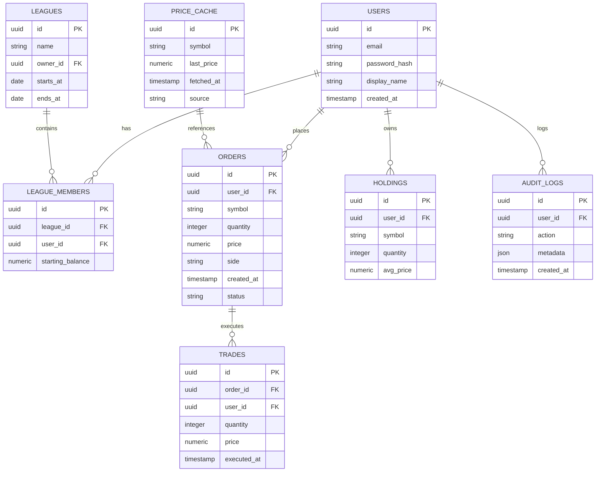
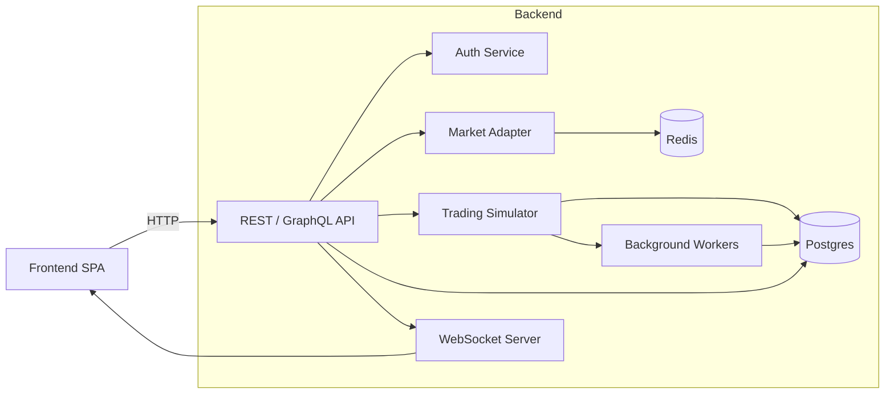
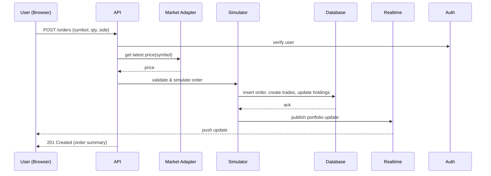

# Architecture

High-level components and data flows for the On-Demand paper trading app.

Components

- Frontend: SPA (React/Vue) for search, orders, portfolio, and leaderboards.
- Backend API: Auth, order simulation, portfolio calculations, and business logic.
- Database: Persist users, portfolios, trades, leagues, and audit logs.
- Market data adapter: Normalizes and caches quotes from providers.
- Trading engine (simulator): Validates orders and computes fills and P/L.
- Real-time: WebSockets for live price updates and leaderboard refreshes.

Data flow

1. Frontend requests quote -> Backend market adapter (cached) -> Provider.
2. User places order -> Backend validates -> Trading simulator updates DB.
3. Portfolio endpoint aggregates holdings + latest prices -> Frontend.

Integration points

- Market API (Alpha Vantage, Twelve Data, etc.)
- Authentication provider (email/password, OAuth optional)
- Optional analytics (e.g., Amplitude) and monitoring

Detailed architecture

This section expands the components, shows the ERD and sequence flows,
and lists the core database schemas required for an MVP.

Mermaid ERD (core tables)



Component diagram



Sequence: place order



Core schemas (draft SQL)

```sql
CREATE TABLE users (
	id UUID PRIMARY KEY,
	email TEXT UNIQUE NOT NULL,
	password_hash TEXT NOT NULL,
	display_name TEXT,
	created_at TIMESTAMP DEFAULT now()
);

CREATE TABLE orders (
	id UUID PRIMARY KEY,
	user_id UUID REFERENCES users(id),
	symbol TEXT NOT NULL,
	quantity INT NOT NULL,
	price NUMERIC(18,6) NOT NULL,
	side TEXT CHECK (side IN ('buy','sell')),
	status TEXT,
	created_at TIMESTAMP DEFAULT now()
);

CREATE TABLE trades (
	id UUID PRIMARY KEY,
	order_id UUID REFERENCES orders(id),
	user_id UUID REFERENCES users(id),
	quantity INT,
	price NUMERIC(18,6),
	executed_at TIMESTAMP DEFAULT now()
);

CREATE TABLE holdings (
	id UUID PRIMARY KEY,
	user_id UUID REFERENCES users(id),
	symbol TEXT,
	quantity INT,
	avg_price NUMERIC(18,6)
);
```

Non-functional requirements (short)

- Latency: API responses for order placement < 300ms (simulation only).
- Throughput: initial target 1000 concurrent users, scale via workers.
- Retention: trades stored indefinitely, price cache TTL 30s (configurable).
- Availability: deploy multiple API replicas behind a load balancer.

Recommended stack

- Backend: Python + FastAPI or Node.js + Fastify
- DB: PostgreSQL
- Cache: Redis (price cache, rate-limiting, sessions)
- Realtime: WebSockets (ASGI/Socket.IO)
- Background jobs: Celery/RQ or Bull (Node)
- Container: Docker, optional Kubernetes for production

Next steps

1. Approve stack choices.
2. Create `md/diagrams/` for exported diagram images.
3. Draft full API contract after schemas are stable.

